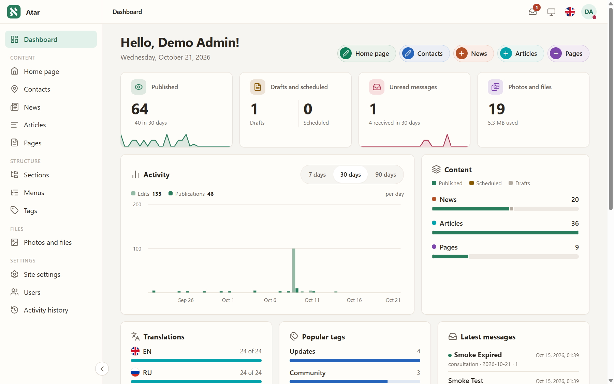
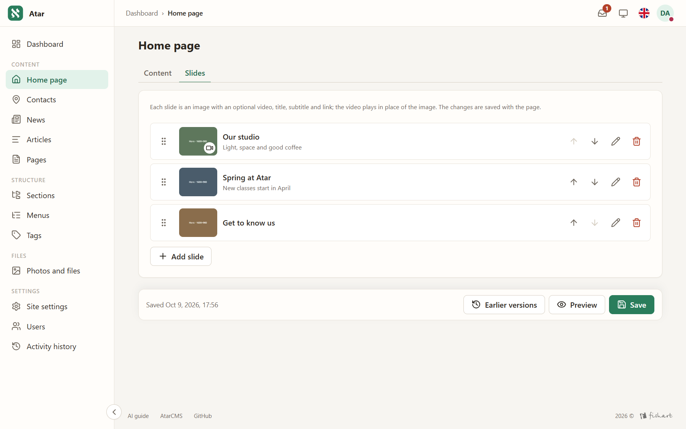
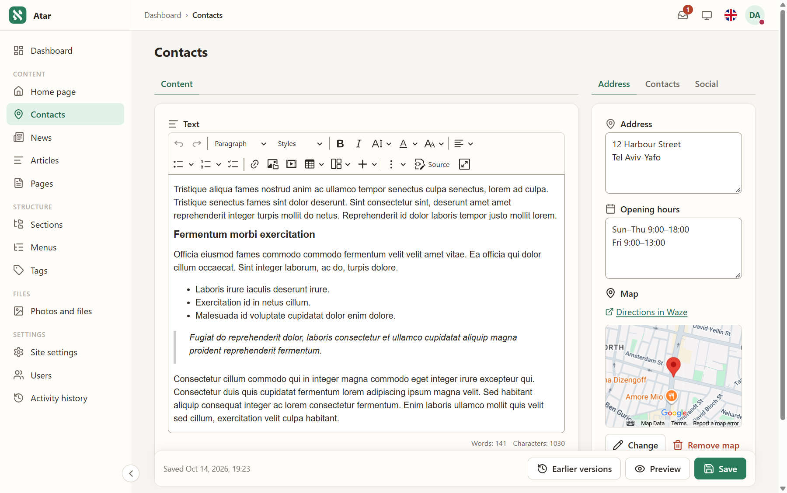
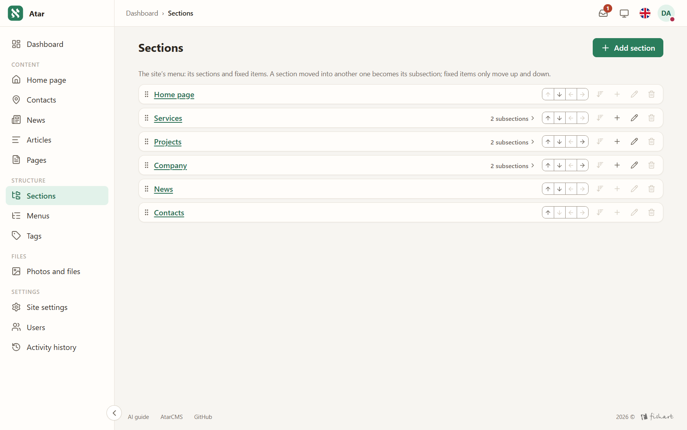

<p align="center">
  
</p>

<h1 align="center">AtarCMS</h1>

<p align="center">
  <b>A small multilingual CMS that AI agents can build, run and read.</b><br>
  PHP 8.4 · no build step · one small VPS is enough
</p>

<p align="center">
  <a href="#ai-ready-end-to-end"></a>
  <a href="https://agentcheck.dev/r/66mU7j2dTbDfM4VwP_oqBulG"></a>
  <a href="LICENSE"></a>
  
  <a href="https://packagist.org/packages/yanfishel/atarcms-core"></a>
</p>

AtarCMS runs small sites — a studio, a clinic, a club, a workshop — with one to five trusted editors: sections
and menus, entries with revisions, autosave and preview, a media library with on-demand WebP/AVIF variants,
search, forms with a message inbox, SEO with generated share images, analytics behind a consent banner, an
accessibility toolbar, and an admin in five languages (English, Russian, Hebrew with full RTL, German, French).
Everything boots from the sources on plain OPcache: no compiled cache, no build step, no node_modules.

## AI-ready, end to end

Being readable and operable by AI agents is the project's central design goal, not an add-on. A site built on it —
[atarcms.com](https://atarcms.com) itself — scores a clean sheet in Lighthouse on mobile and desktop, Performance
included, and passes Google's new **agentic browsing** audit:


Every stage of a site's life has an AI surface:

**1. An agent builds the site.** The skeleton ships an agent skill (`.agents/skills/building-atarcms-sites/`,
wired up by `AGENTS.md`): a coding agent installs AtarCMS, builds the theme from a design brief, configures
languages, sections and menus, fills demo content and walks the go-live checklist.

**2. An agent runs the admin.** The admin describes itself at **`/admin/ai-guide`** — one known URL instead of
hidden per-page hints. A signed-in browser agent gets the screens it may open, every content type with its
fields and limits, and how saving, autosave, translations and media work — generated for this site and filtered
by that user's permissions. The admin itself works without JavaScript, renders semantic markup and never hides
state in scripts, so agents driving the accessibility tree operate it reliably.

**3. Agents and LLMs read the published site.** The public site is machine-readable without scraping:

- **`/llms.txt`** — the whole site as a markdown map ([llmstxt.org](https://llmstxt.org)), one request:

  ```markdown
  # Atar Demo

  > A demo site with sections, articles, news and a contact form.

  Site languages: en (default), ru, he

  Append .md to an entry's URL for a markdown version.

  The full text of the entry pages: https://example.com/llms-full.txt

  ## News (en)

  - [Spring at Atar](https://example.com/news/spring-at-atar)
  ```

- **`/llms-full.txt`** — the full text of the public entry pages in one request (`/llms.txt`'s order, each page's
  markdown twin with a `Source:` line); after `content.llms_full_limit` pages (default 100) or 1 MiB it points to
  `/llms.txt`. Both files speak the site's default language.

- **`{page URL}.md`** — every public entry page has a markdown twin: the same content as clean markdown
  (`text/markdown`), with a `Link: rel="canonical"` header back to the HTML page and `X-Robots-Tag: noindex` so
  search engines never see duplicates. Old addresses redirect with 301, like the HTML pages:

  ```console
  $ curl https://example.com/contacts.md
  # Contacts

  - Language: en (translations: [he](…/he/contacts.md), [ru](…/ru/contacts.md))

  ## Text
  …
  ```

"Hide from search engines" hides `/llms.txt`, `/llms-full.txt` and the `.md` twins along with the sitemap, so a site
under construction leaks nothing. Details: `docs/architecture.md` ("AI readiness") and `docs/admin-ui.md` ("Shell",
the AI guide).

## A look inside

| | |
| --- | --- |
|  **The dashboard** — activity, content and translation state at a glance |  **Entry form** — tabs per field group, hero slides with optional video |
|  **Rich text** (CKEditor 5) beside structured fields — address, hours, a Google map |  **Sections** — the site's menu as a tree: drag to nest, every change audited |
|  **Full RTL** — the same admin in Hebrew, mirrored by logical CSS |  **The default theme** — hero slides with video, dropdown menus, search, a language menu, the accessibility toolbar |

## What is in the box

- **Content:** collections and singles defined in code, entries with revisions, autosave, preview, scheduled
  publication; sections (hierarchical menus with addresses), tags and custom taxonomies; slug history with 301s;
  hero slides with optional self-hosted video; preset pages (privacy policy, accessibility statement).
- **Multilingual by design:** per-language content with linked translations, hreflang alternates, localized
  sitemaps and feeds; machine translation of a form in place (Chrome's on-device Translator API).
- **Media:** folders, bulk upload, alt texts per language, image variants on demand (WebP, AVIF, art direction),
  self-hosted video, YouTube/Vimeo embeds.
- **Public site:** themes of plain PHP templates with a strict Content Security Policy (no inline scripts or styles
  in templates, one nonce'd bootstrap, no third-party hosts), search, contact and custom forms with rate limiting
  and a message inbox, a Google map and a messenger chat button, generated share images, JSON-LD, feeds, sitemap,
  robots.txt — and the AI surfaces above.
- **Operations:** a dashboard; the `bin/atar` console (installation doctor, migrations, user management, one-time
  login links, a theme scaffold and checker, demo content); audit log of every change, Google sign-in, deploy
  configs for nginx/Caddy/Apache, Docker setups for development and production.
- **Visitors:** accessibility toolbar, cookie consent (statistics and advertising separately) gating Metrica,
  GA4 and ad pixels, dark/light theme.

## Quick start

A site starts from the skeleton, its own repository
([`yanfishel/atarcms`](https://github.com/yanfishel/atarcms), exported from `skeleton/` with every
version tag), and gets this core as the Composer package `yanfishel/atarcms-core`:

```bash
composer create-project yanfishel/atarcms my-site --no-interaction
```

Then: edit `.env` (`APP_URL`, `DB_*`; `create-project` has copied it), run `php bin/atar migrate`, create the first
administrator with `php bin/atar user:create you@example.com --role=admin` and sign in with the one-time URL
`php bin/atar user:login-link you@example.com` prints — or hand the whole thing to a coding agent, which reads
`AGENTS.md` and does the same. Every installation path (Docker or not, local, a server, shared hosting) is in
the skeleton's `.agents/skills/building-atarcms-sites/references/install.md`, and `php bin/atar doctor` checks
the result.

**Requirements:** PHP 8.4 (gd with FreeType, intl, mbstring, pdo_mysql, exif, fileinfo, dom), MariaDB 10.11+ (MySQL
8.0.21+ works but is untested), any web server (configs for nginx, Caddy and Apache ship) — or just Docker.
`php bin/atar doctor` names whatever is missing.

## Documentation

| | |
| --- | --- |
| `docs/architecture.md` | How every subsystem works, with the decisions behind it |
| `docs/theme-guide.md` | Building a public theme: templates, helpers, rules, a recipe |
| `docs/admin-ui.md` | The admin: design tokens, screens, the rules tests enforce |
| `docs/releasing.md`, `UPGRADE.md` | Versions, the release pipeline, what a site does after an update |
| `skeleton/HANDBOOK.md` | The site owner's and developer's reference: theme, content model, admin, console, production |

`docs/` is not part of the Composer package; read it here on GitHub.

Versions are git tags (`v0.1.0`…); what changed is in `CHANGELOG.md`. This repository is a per-release mirror
of a private development repository (`CONTRIBUTING.md`); issues and security reports (`SECURITY.md`) live here.

## Development

Everything runs in Docker:

```bash
docker compose run --rm php composer install
docker compose run --rm php composer check   # PHP-CS-Fixer, PHPStan at level max, PHPUnit
```

The runnable demo site lives in `skeleton/` (see `skeleton/README.md`).
`cd skeleton && docker compose up -d --build` serves it on http://localhost:8080 against this working tree
(`skeleton/compose.override.yaml`).

## Licence

AtarCMS's own code is released under the MIT licence (`LICENSE`). The vendored third-party components keep their
own licences (see "Third-party components"); the admin's rich-text editor is the GPL build of CKEditor 5, so a
redistribution of AtarCMS together with it must honour the GPL for that component.

## Third-party components

- **CKEditor 5** 48.5.2 (the admin's rich-text editor), GPL-2.0-or-later, source:
  https://github.com/ckeditor/ckeditor5/tree/v48.5.2. Its files and licence (`ckeditor5.LICENSE`,
  `ckeditor5.COPYING.GPL`) are in `resources/admin/assets/vendor/`.
- **htmx** 2.0.4 (the admin's partial page updates), Zero-Clause BSD: `resources/admin/assets/vendor/htmx.LICENSE`.
- **SortableJS** 1.15.7 (drag-and-drop ordering in the admin), MIT: `resources/admin/assets/vendor/sortable.LICENSE`.
- **Lucide** 1.49.0 icons (a subset as the admin's SVG sprite), ISC: `resources/admin/assets/icons.LICENSE`.
- **Open Sans** Bold (the text of generated share images), SIL OFL 1.1: `resources/fonts/OpenSans-OFL.txt`.
- **Cardo** Bold (the aleph of the logo, as artwork; no font file shipped), SIL OFL 1.1:
  `resources/admin/assets/logo/Cardo-OFL.txt`, `NOTICE.txt`.
- The skeleton's default theme adds **PhotoSwipe** 5.4.4 (MIT), the **Rubik** font (SIL OFL 1.1), **Lucide** icons
  (ISC) and **Simple Icons** 16.34.0 brand icons (CC0); their licence files sit next to them in
  `skeleton/themes/default/assets/`.
