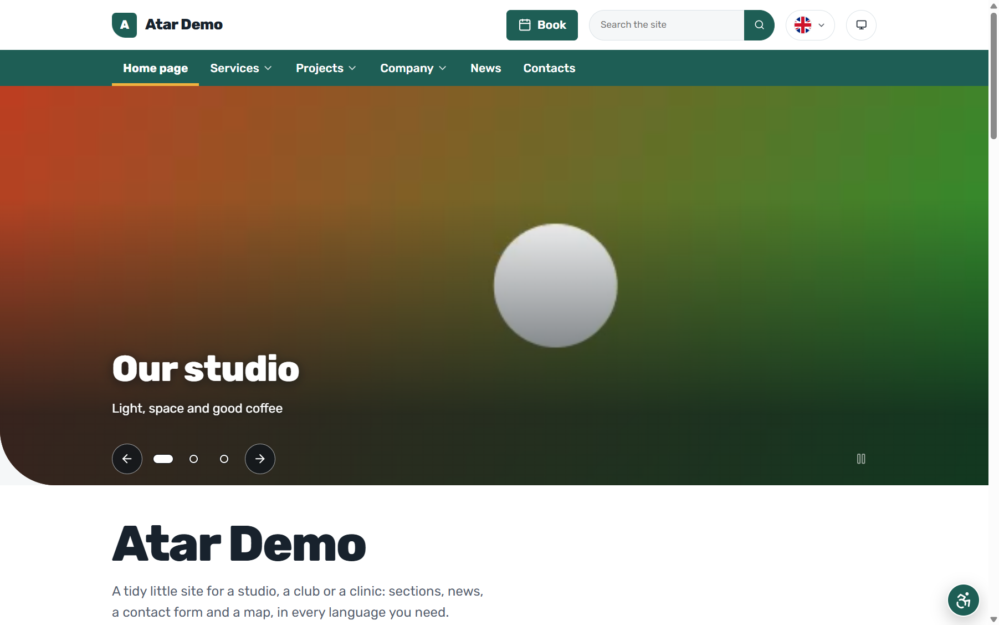
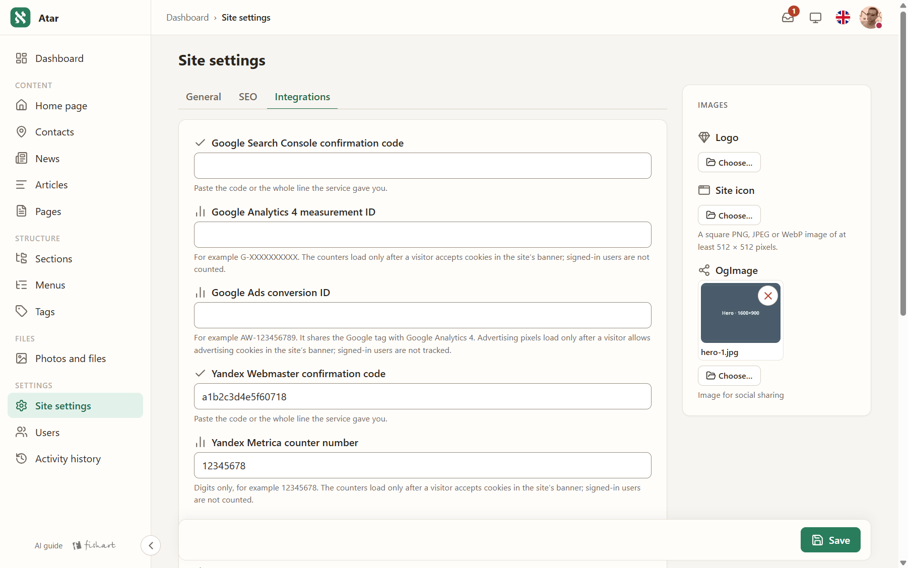
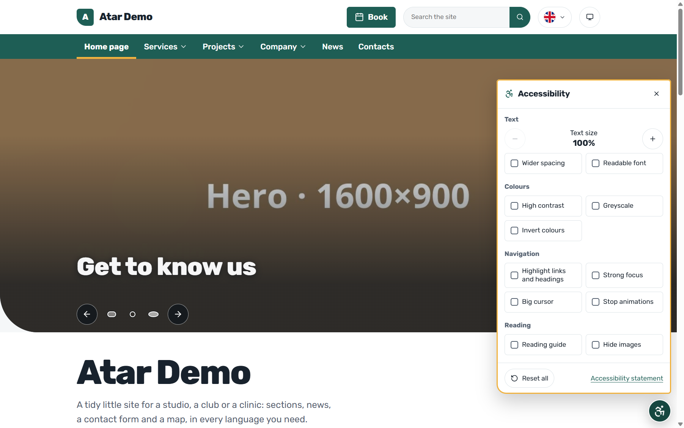
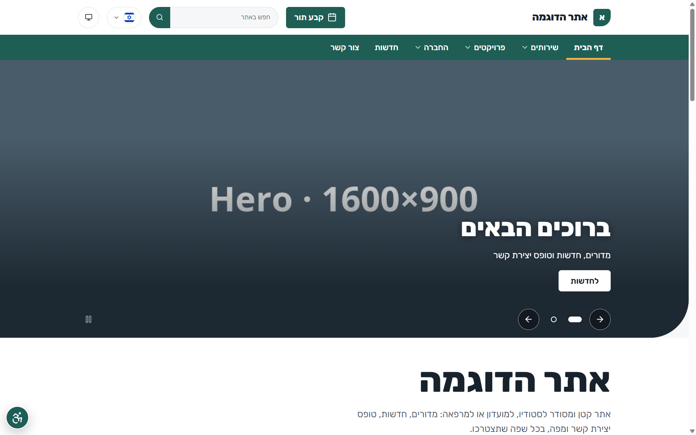
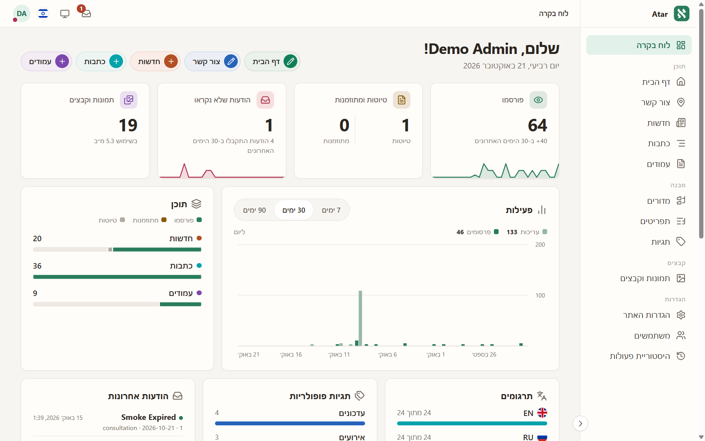

<p align="center">
  
</p>

<h1 align="center">AtarCMS site skeleton</h1>

<p align="center">
  <b>A ready-to-run site on <a href="https://github.com/yanfishel/atarcms-core">AtarCMS</a> — built, run and read by AI agents.</b>
</p>

<p align="center">
  <a href="https://github.com/yanfishel/atarcms-core#ai-ready-end-to-end"></a>
  <a href="https://agentcheck.dev/r/66mU7j2dTbDfM4VwP_oqBulG"></a>
  <a href="LICENSE"></a>
  <a href="https://packagist.org/packages/yanfishel/atarcms"></a>
</p>

A multilingual site with sections, news, articles, pages, a contact form, search and a media library — and AI
surfaces on every side of it:

- **Build it with an agent:** the skill in `.agents/skills/building-atarcms-sites/` takes a coding agent from an
  empty folder to a launched site (`HANDBOOK.md`, "Building the site with an AI agent").
- **Run it with agents:** the admin describes itself to a signed-in browser agent at `/admin/ai-guide`
  (`HANDBOOK.md`, "AI agents").
- **Let AI read it:** the public site publishes `/llms.txt` and `/llms-full.txt`, and every entry page answers at
  its address plus `.md` as clean markdown.



## What your site can do

A site built on AtarCMS — [atarcms.com](https://atarcms.com) itself — scores a clean sheet in Lighthouse on mobile
and desktop, Performance included, and passes Google's new **agentic browsing** audit, which checks that AI agents
can use the site:

<p align="center">
  
</p>

### Found by search engines — and by AI

Localized sitemaps, hreflang alternates, canonical URLs, titles and descriptions inherited along sections,
JSON-LD (organization, articles, breadcrumbs), generated share images for link previews, 301 redirects when an
address changes. And the GEO side: `/llms.txt` maps the whole site for language models in one request,
`/llms-full.txt` gives its full text, and every entry page has a markdown twin — when someone asks ChatGPT or Claude
about your business, your site is the easy source to read. "Hide from search engines" hides all of it while the
site is under construction.

### Content that editors manage themselves

Sections form the site's menu; news, articles and pages have revisions, autosave, preview and scheduled
publication; forms (contact, booking — defined per site) collect messages into an admin inbox and send mail; a
Google map, messenger chat button, privacy policy and other preset pages are built in. Every change is audited.

| The dashboard | Rich text, address and the map |
| --- | --- |
|  |  |

### Statistics and pixels without code

Yandex Metrica (with optional session replay), Google Analytics 4, site verification for Search Console and
Yandex Webmaster, and the ad pixels — Meta, Google Ads, VK Ads, TikTok — are each one field in Site settings. A
cookie banner asks visitors first (statistics and advertising as separate choices, in every site language);
nothing loads before consent, and signed-in editors are never counted. Google Tag Manager is deliberately not
supported: it would break the site's strict Content Security Policy, which keeps scripts you did not choose off
your pages.



### Accessible to every visitor

A built-in accessibility toolbar lets visitors enlarge text, widen spacing, raise contrast, switch to greyscale or
inverted colours or a readable font, mark links and headings, strengthen the focus ring, enlarge the cursor, stop
motion, use a reading guide or hide images — no third-party widget. An
accessibility statement page ships as a preset, the theme respects `prefers-reduced-motion`, and the admin
itself works without JavaScript.



### In every language you need

Content, menus, search and feeds per language, with linked translations in the admin and machine translation of
a form in place (Chrome's on-device translator). Right-to-left languages are first-class: the whole site and the
whole admin mirror correctly in Hebrew.

| The site in Hebrew | The admin in Hebrew |
| --- | --- |
|  |  |

### Fast by design

No build step and no JavaScript frameworks: pages render on the server and ship a few small scripts only where
needed. Images are converted to WebP and AVIF on demand with phone-sized crops for phones; the shipped nginx,
Caddy and Apache configs compress text responses; the first hero picture loads first (a video slide's poster is
preloaded). Small sites on one small VPS stay fast.

## Install

AtarCMS and this skeleton are open-source Composer packages (`yanfishel/atarcms-core`, `yanfishel/atarcms`, MIT) on
Packagist, with their source on GitHub: installing needs no account and no token. You need PHP 8.4 and MariaDB
10.11+, or just Docker; `php bin/atar doctor` names whatever is missing. A new site is:

```bash
composer create-project yanfishel/atarcms my-site --no-interaction
```

Every way to run it (your computer or a server, with or without Docker, shared hosting) is in
`.agents/skills/building-atarcms-sites/references/install.md`, and `php bin/atar doctor` checks the result.
With Docker the site runs locally on http://localhost:8080, its mail caught by Mailpit at http://localhost:8025
(`HANDBOOK.md`, "Development with Docker").

**With an AI agent.** Open your coding agent in an empty folder (on your computer, or with SSH access to the
server) and paste:

```text
Clone https://github.com/yanfishel/atarcms.git with --depth 1 into a temporary folder
(install git first if it is missing), read .agents/skills/building-atarcms-sites/references/install.md
there and install AtarCMS: into ./my-site on this computer, or into /var/www/<site> on a server;
then open the site's folder and continue with its skill.
```

The agent asks before it installs packages or changes a server, and you type the secrets yourself.

**What to have ready.** The agent will interview you; answers prepared up front turn several rounds into one.
Useful to have: what the site is about and for whom, and its name; the languages; the pages and sections you
imagine (unsure is fine — the agent proposes); a site you like as a style sample, or a purchased template — then
**its files and its licence**, not just its address; contacts (phone, email, address or online-only, opening
hours, messengers) and social links; texts, photos and a logo you already have; anything that must *not* appear
on the site. Needed only for launch day, not sooner: the domain, an SMTP mailbox for the forms' mail, analytics
counter numbers and, optionally, a Google OAuth client for "Sign in with Google".

## Everything else

How the site works under the surface — the theme and its helpers, the content model, the admin, languages, media,
search, the console commands, going to production — is one document: **[`HANDBOOK.md`](HANDBOOK.md)**.

## Licence

The skeleton and the AtarCMS core are MIT-licensed (`LICENSE`): free for any site, commercial ones included.
What you build on it — your theme, your module, your content — is yours. A new site starts with
`"license": "MIT"` in its `composer.json`; if your own site code should be something else, change that field.
The core's admin bundles the GPL build of CKEditor 5, which matters only if you redistribute AtarCMS itself,
not for running a site (the core README's "Licence" and "Third-party components" have the details).
